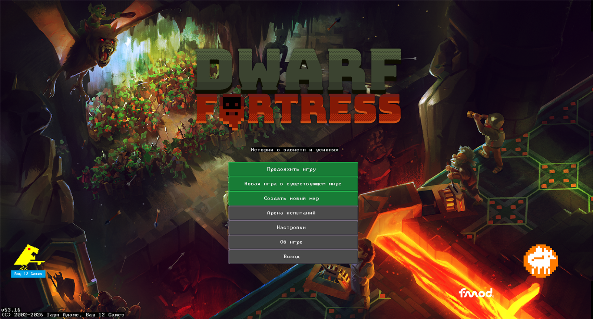
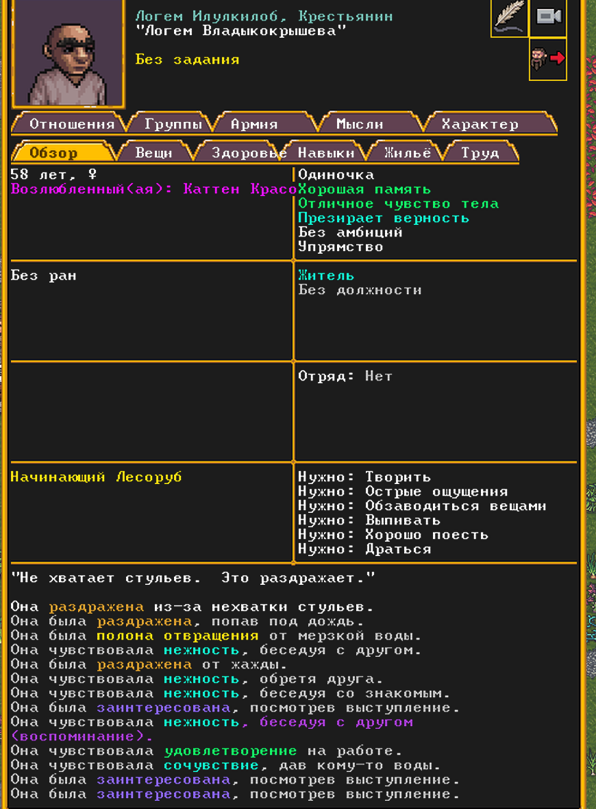

# Русификатор Dwarf Fortress

Полный перевод Dwarf Fortress на русский язык для версии из Steam.

Переведено всё, что вы видите в игре: меню и кнопки, подсказки, сообщения, мысли и характеры жителей,
названия существ, предметов и материалов, имена дварфов и названия мест, легенды и история мира.
Русские слова согласуются между собой: «медная кирка», «носок из шерсти альпаки», «брёвна из древесины яблони».

## Установка

1. Скачайте установщик: **[DF-RU-Setup.exe](https://github.com/F0Xed0/DF-RU/releases/latest/download/DF-RU-Setup.exe)**
   (все версии — на странице [выпусков](https://github.com/F0Xed0/DF-RU/releases)).
2. Запустите скачанный файл. Если Windows покажет окно «Система Windows защитила ваш компьютер»,
   нажмите «Подробнее», а затем «Выполнить в любом случае». Это предупреждение появляется у любых
   программ без платной цифровой подписи.
3. Нажимайте «Далее», а в конце — «Установить». Установщик сам найдёт игру в Steam.

Готово. Запустите Dwarf Fortress и создайте новый мир.

Миры, созданные до установки русификатора, сохранят английские названия мест и имена — игра
придумывает их один раз, при создании мира. Меню, сообщения и всё остальное будет на русском и в них.

## Как это выглядит в игре

## Требования

- Dwarf Fortress из Steam, версия 53.16.
- Windows 10 или 11.

## Удаление

Запустите **DF-RU-Setup.exe** ещё раз, выберите «Удалить русификатор и вернуть оригинальные файлы»
и нажмите «Далее» до конца. Установщик вернёт файлы игры, которые сохранил при установке.

Если вы устанавливали русификатор не установщиком, а вручную, откройте в Steam свойства игры,
раздел «Установленные файлы», и нажмите «Проверить целостность файлов игры».

## Частые вопросы

**Интерфейс остался на английском, а названия существ — на русском.**
Скорее всего, игра обновилась, и её версия больше не 53.16. В таком случае часть перевода, отвечающая
за интерфейс, отключается сама, чтобы не мешать игре. Дождитесь новой версии русификатора.

**У меня установлен DFHack.**
DFHack и русификатор используют один и тот же файл dfhooks.dll, поэтому вместе они не работают.
Установщик предупредит об этом. Если удалить русификатор, DFHack снова заработает.

**Антивирус ругается на установщик.**
Установщик не подписан цифровой подписью, поэтому некоторые антивирусы относятся к нему с подозрением.
Он только копирует файлы перевода в папку игры и сохраняет заменённые файлы в папку df-ru-backup
внутри папки игры.

**Можно ли играть в старых сохранениях?**
Да. Сохранения не меняются, а их тексты переводятся на лету. Только имена и названия мест в старых мирах
останутся английскими.

**В режиме классических символов (ASCII) текст выглядит неправильно.**
Этот режим не поддерживается: русификатор рассчитан на обычную графику Steam-версии.

## Ручная установка

Для тех, кто не хочет запускать установщик. Сделайте копию папки игры, затем скопируйте всё содержимое
папки [translation](translation) из этого репозитория в папку игры с заменой файлов.
Папку игры можно открыть в Steam: правой кнопкой по игре, «Управление», «Просмотреть локальные файлы».

## Если нашли ошибку

Сообщайте о непереведённых местах и неудачных фразах в разделе
[Issues](https://github.com/F0Xed0/DF-RU/issues). Скриншот очень помогает.

## Лицензия

Перевод распространяется по лицензии
[Creative Commons BY-NC-SA 4.0](LICENSE): его можно свободно использовать, изменять и распространять
с указанием авторства, только некоммерчески и на тех же условиях.

Dwarf Fortress принадлежит Bay 12 Games и Kitfox Games. Это любительский перевод, не связанный
с разработчиками. Для работы русификатора нужна купленная копия игры.
